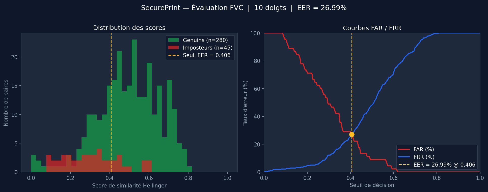

# SecurePrint - Encrypted Fingerprint Authentication

> Desktop fingerprint enrolment and authentication system that never stores fingerprint images: a 256-dimension descriptor is encrypted with Fernet (AES-128-CBC + HMAC-SHA256) in SQLite, with a Fuzzy Vault module, GDPR-style data management and FVC2000 evaluation.

## Overview

Biometric templates are sensitive: unlike a password, a leaked fingerprint cannot be changed. SecurePrint explores how to build a fingerprint authentication system that protects templates at rest and follows GDPR principles (data minimisation, non-reversibility, right to erasure).

The pipeline turns a fingerprint image into a ridge skeleton, extracts minutiae, summarises the skeleton as a compact 256-value descriptor, encrypts it and stores only the ciphertext. Authentication re-computes the descriptor under several rotations and compares it with the decrypted reference using Hellinger similarity. A Juels-Sudan **Fuzzy Vault** is implemented as a separate cryptographic module and was evaluated in standalone experiments.

## Key features

- **Image preprocessing:** global normalisation, CLAHE, adaptive Gaussian thresholding, morphological cleaning, skeletonisation (scikit-image) and pruning of short spurs.
- **Minutiae extraction:** Crossing Number on the 3x3 neighbourhood of the skeleton (ridge endings and bifurcations).
- **Non-invertible template:** 256 float32 values = 8x8 ridge-density grid + 8x8 orientation grid + 4x4x8 HOG descriptor. The original image is never stored.
- **Encryption at rest:** each template is encrypted with Fernet (AES-128-CBC with HMAC-SHA256 authentication, random IV) before it reaches SQLite.
- **Matching:** Hellinger similarity, best score over candidate rotations from -30 to +30 degrees, default threshold 0.40.
- **Fuzzy Vault (`modules/fuzzy_vault.py`):** secret polynomial over a prime field, genuine points derived from rotation/translation-invariant local minutiae descriptors (3 nearest neighbours), chaff points, and key recovery by Lagrange interpolation. It is not wired into the default login flow.
- **GDPR-oriented storage:** `users` and `templates` tables with `ON DELETE CASCADE`, so deleting a user from the management tab erases every template.
- **Role-based GUI (CustomTkinter):** on first run all tabs are open so the first administrator can enrol; afterwards only the authentication tab is visible until a user with the `admin` role authenticates, which unlocks Enrolment, Management and FVC Evaluation.
- **Biometric evaluation:** FVC protocol (genuine pairs = all impressions of the same finger, impostor pairs = first impressions of different fingers) with FAR, FRR, EER and score-distribution plots, available in the GUI and on the command line.

## Tech stack

Python 3.10+, OpenCV, scikit-image, NumPy, scikit-learn, cryptography (Fernet), SQLite, CustomTkinter, Pillow, Matplotlib.

## Project structure

```
.
├── main.py                  entry point: GUI, --cli-test, --fvc2000-eval
├── fvc2000_benchmark.py     command-line FVC evaluation (FAR / FRR / EER)
├── prepare_socofing.py      converts SOCOFing to the FVC file layout
├── requirements.txt
├── modules/
│   ├── preprocessor.py      1 - preprocessing (CLAHE, thresholding, skeleton)
│   ├── minutiae.py          2 - minutiae extraction (Crossing Number)
│   ├── template.py          3 - 256-dim descriptor
│   ├── fuzzy_vault.py       4 - Fuzzy Vault (polynomial + chaff + Lagrange)
│   ├── encryption.py        5 - Fernet key management and encryption
│   ├── storage.py           6 - SQLite storage, right to erasure
│   ├── matcher.py           7 - Hellinger matching with rotation search
│   ├── alignment.py         skeleton cropping / alignment helper
│   └── evaluator.py         FVC protocol and plots
├── ui/main_window.py        CustomTkinter interface
├── scripts/
│   ├── set_admin_role.py    promote an enrolled user to admin
│   ├── wipe_db.py           delete all enrolled users and templates
│   └── experiments/         manual experiment scripts (need FVC2000 images)
└── results/                 FVC2000 evaluation plots
```

## Getting started

### Prerequisites
- Python 3.10+ with Tkinter (included in the standard Windows/macOS installers; on Linux install `python3-tk`)

### Install
```bash
python -m venv .venv
# Windows: .venv\Scripts\activate    Linux/macOS: source .venv/bin/activate
pip install -r requirements.txt
```

### Encryption key and database
The `database/` folder is **not** in the repository. On first launch (`python main.py` or `python main.py --cli-test`) the application creates it automatically:
- `database/master.key` - a new random Fernet key (never overwritten if it already exists);
- `database/secureprint.db` - the SQLite database and its tables.

Keep `master.key` private: templates encrypted with one key cannot be decrypted with another. For production use, the key should live in an HSM or OS keystore rather than a file.

### Configuration (optional)
| Variable | Purpose |
|---|---|
| `SECUREPRINT_ADMIN_NAME` | Restrict admin-mode unlock to this enrolled user name. If unset, any user with the `admin` role unlocks admin mode. |

See `.env.example`. The app reads the variable from the environment (it does not load `.env` files):
```bash
# Linux/macOS
export SECUREPRINT_ADMIN_NAME=alice
# Windows PowerShell
$env:SECUREPRINT_ADMIN_NAME = "alice"
```

### Datasets
Fingerprint images are **not** included. Download them separately and respect each dataset's licence:
- **FVC2000** (DB1_B etc.) from the [FVC2000 site](http://bias.csr.unibo.it/fvc2000/) - place files as `data/fvc2000/DB1_B/101_1.tif`, ...
- **SOCOFing** from [Kaggle](https://www.kaggle.com/datasets/ruizgara/socofing) - place it in `data/samples/SOCOFing/` and convert it to the FVC layout:
  ```bash
  python prepare_socofing.py --src data/samples/SOCOFing --out data/fvc_ready --max-subjects 30
  ```

### Run
```bash
python main.py                                   # GUI
python main.py --cli-test                        # headless end-to-end check (synthetic template; uses FVC images if present)
python fvc2000_benchmark.py --db data/fvc2000/DB1_B --plot results/eval.png
python main.py --fvc2000-eval --db data/fvc2000/DB1_B
python scripts/set_admin_role.py <user-name>     # promote an existing user to admin
python scripts/wipe_db.py                        # remove all enrolled users
python -m scripts.experiments.test_vault         # experiment scripts: run as modules from the project root
```
The scripts in `scripts/experiments/` are development experiments, not an automated test suite; some target earlier Fuzzy Vault template formats.

## Results

FVC protocol on 10 fingers of FVC2000 DB1_B (280 genuine pairs, 45 impostor pairs), as reported in the project report:

| Metric | Value |
|---|---|
| Equal Error Rate (EER) | 26.88% |
| EER threshold | 0.4057 |
| System threshold | 0.40 |

A later run of the same evaluation (below) gave EER = 26.99% at threshold 0.406.



An EER around 27% reflects the limits of a global (density + orientation + HOG) descriptor compared with minutiae-alignment or learned descriptors. Improvement paths identified in the report: core-point or Hough-based alignment, local invariant descriptors, CNN-based feature extraction, multi-template enrolment and an encrypted database engine such as SQLCipher.

## Security notes

- Fernet uses **AES-128** in CBC mode with HMAC-SHA256, not AES-256.
- The encryption key is stored next to the database in this academic version; anyone with both files can decrypt the templates.
- The Fuzzy Vault module is a research implementation and is not part of the default login path.

## Academic context

Final-year project (Projet de Fin d'Études) for the *Licence Appliquée en Génie Informatique* at **TEKUP** (Tunis), academic year 2024-2025, specification no. 4: encrypted biometric authentication.

## Author

- **Nasrallah Hadhri** - [github.com/Nasrallah-Hadhri](https://github.com/Nasrallah-Hadhri)

Developed as a team project at TEKUP.

## License

[MIT](LICENSE)
